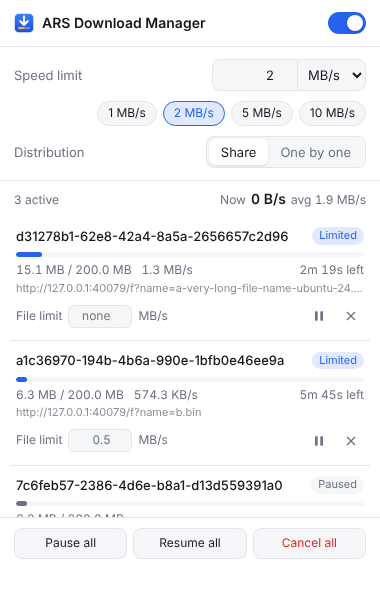

# ARS Download Manager — Installation Guide

*🇹🇷 Türkçe: [KURULUM.md](KURULUM.md)*

This guide is written for people with **no computer experience at all**. Follow the steps in order and don't skip any.
Total time: **about 5 minutes.**

> **What does this extension do?**
> If your internet freezes while Chrome downloads a big file, this extension slows the download down **without stopping it**.
> The download keeps going, and you can still watch videos or browse comfortably.

---

## What you need

- **Google Chrome** installed on your computer. Nothing else.

---

## Part 1 — Installation

### Step 1: Download the extension

1. Open this page: **https://github.com/Arslan-TR/ARS-Download-Manager-for-chrome/releases/latest**
2. Further down the page, find the **`Assets`** heading.
3. Click **`ARS-Download-Manager-v.….zip`** under it (for example `ARS-Download-Manager-v.0.26.1.zip`).
   *(**Don't click** the "Source code" files next to it; those are for developers.)*

✅ **What happens?** A file starting with `ARS-Download-Manager-v.` and ending with `.zip` is saved to your computer.
It usually goes into your **Downloads** folder.

---

### Step 2: Unzip the file

The downloaded file is a compressed package. We need to open it first.

**On Windows:**
1. Open your Downloads folder.
2. **Right-click** the downloaded file.
3. Click **`Extract All...`**.
4. In the window that opens, click **`Extract`**.

**On a Mac:**
1. **Double-click** the downloaded file. It opens by itself.

✅ **What happens?** A **yellow folder** with the same name appears next to it.

---

### Step 3: Put the folder somewhere permanent

> ⚠️ **VERY IMPORTANT:** Chrome runs the extension **from this folder** every time.
> If you delete the folder or move it, **the extension stops working.**

1. Move the yellow folder into your **Documents** folder (drag and drop it).
2. If you like, give it a shorter name, for example: **`ARS Download Manager`**

🔍 **Check:** Double-click the folder to open it. Inside, you should see:
- a file called `manifest.json`
- a folder called `icons`
- a file called `popup.html`

❗ If you don't see these, you may have downloaded the wrong file in Step 1 (it must be the file starting with `ARS-Download-Manager-v.`, not "Source code").

---

### Step 4: Open Chrome's extensions page

1. **Open Chrome.**
2. In the address bar at the very top (where you normally type website addresses), type exactly this:

   ```
   chrome://extensions
   ```

3. Press **Enter** on your keyboard.

✅ **What happens?** A page titled "Extensions" opens.

---

### Step 5: Turn on "Developer mode"

1. Look at the **top right corner** of this page.
2. Click the **switch** next to **`Developer mode`**. It should turn blue.

> 🙂 Don't worry, this is harmless. It only lets you install extensions from your own computer.

✅ **What happens?** A few new buttons appear near the top of the page.

---

### Step 6: Install the extension

1. Click the **`Load unpacked`** button that appeared at the top left.
2. A window for choosing a folder opens.
3. Find the **folder from Step 3** (inside Documents).
4. **Don't go into** the folder, just **click it once to select it.**
5. Click the **`Select Folder`** button.

✅ **What happens?** A card called **"ARS Download Manager" with a blue icon** appears on the page. Installation done! 🎉

❗ If a red error appears with the word **"manifest"** in it: you picked the wrong folder. Go back to **🔍 Check** in Step 3.

---

### Step 7: Pin the icon to the toolbar

Let's make the extension's icon visible so it's easy to open.

1. Click the **puzzle piece (🧩)** button in the **top right corner** of Chrome.
2. Find **ARS Download Manager** in the list.
3. Click the **pin (📌)** next to it.

✅ **What happens?** A small **blue icon with a down arrow** appears at the top right. This is where you'll open the extension from now on.

**Installation is finished!** Now let's see how to use it.

---

## Part 2 — Using it



### Limiting the speed (the basics)

1. Click the **blue down-arrow icon** at the top right. A small window opens.
2. Turn on the **switch in the top right of the window**. It should turn blue.
3. Click one of the ready-made buttons: **`1 MB/s`**, **`2 MB/s`**, **`5 MB/s`** or **`10 MB/s`**.

That's it! Your downloads will no longer go faster than the speed you picked.
To remove the limit, turn the switch off again.

> 💡 **Tip:** While the limit is on, you'll see small text on the extension icon. For example **`2M`** = "2 MB/s limit is on."

---

### Which speed should I pick?

Internet plans are usually sold in **Mbps** (for example "50 Mbps"). The buttons in the extension use **MB/s**.

**Easy math:** **divide** your Mbps **by 8**, then pick **half** of that.

| Your internet plan | Downloads at about | Suggested limit |
|---|---|---|
| 16 Mbps | ~2 MB/s | **1 MB/s** |
| 50 Mbps | ~6 MB/s | **3 MB/s** (type 3 in the box) |
| 100 Mbps | ~12 MB/s | **5 MB/s** |
| 1000 Mbps (fiber) | ~120 MB/s | **10 MB/s** or more |

To type your own value: write the number in the **"Speed limit"** box and press **Enter**.
You can also choose the unit from the small menu next to it: **KB/s**, **MB/s** or **Mbps**.

---

### The "Distribution" setting: Share or One by one?

This setting only matters when you download **more than one file at the same time**.

- **Share:** The speed is split **equally** between all downloads. They all move forward together.
  *Example: limit is 4 MB/s, 2 downloads → about 2 MB/s each.*
- **One by one:** The download that **started first** gets almost all the speed. When it finishes, the next one takes over.
  Meanwhile, the waiting ones move very slowly in **"Snail"** mode. They **never stop completely**, so their connections don't drop.

If you're not sure, leave it on **Share**.

---

### What do the labels in the list mean?

Each download has a small colored label next to it:

| Label | Meaning |
|---|---|
| **Limited** (blue) | This download is being slowed down to your limit. |
| **Priority** (blue) | In One by one mode, the download that is currently first. |
| **Snail** (orange) | In One by one mode, waiting its turn and moving very slowly. |
| **Unlimited** (green) | The limit is off, it downloads at full speed. |
| **Paused** (gray) | You paused it. The extension **won't touch** it. |

---

### Other buttons

- **⏸ / ▶** (next to each download): pauses or resumes that download.
- **✕** (next to each download): **cancels** that download.
- **File limit** box: puts a separate speed limit on **just that file**. Leave it empty for no separate limit.
- **Pause all / Resume all:** stops or continues all downloads at once.
- **Cancel all:** cancels all downloads. So you don't press it by accident, you have to **click it twice**.

---

### "Why does the speed jump around?" — That's normal!

The extension slows a download down by stopping and restarting it at short intervals.
So the download arrives **in chunks**: sometimes fast, sometimes nothing.

The line above the list shows two speeds:
- **Now:** the total speed of all downloads **right now**. It jumps around (sometimes `0 B/s`, sometimes high). That's normal.
- **avg:** the average over the last 20 seconds. **This is the number to compare with your limit.**

The speed next to each download is a 20-second average too.

---

## Part 3 — Having trouble?

**❓ I got a red error with the word "manifest" in it.**
→ You picked the wrong folder. You need the folder that has the `manifest.json` file inside. See Part 1, Step 3.

**❓ Every time Chrome starts, it shows a warning about "developer mode extensions".**
→ That's normal; it appears because you installed the extension from your computer instead of the store.
**Close** the warning (✕). **Don't click anything like "Disable"**, or the extension will be turned off.

**❓ The extension suddenly disappeared or stopped working.**
→ Most likely you deleted or moved the folder. Put the folder back, or do Part 1 again from the start.

**❓ I turned the limit on, but the download is still very fast.**
→ Make sure the switch in the top right of the window is **blue**.
→ Look at the **avg** value in the top line (not "Now") and wait a little.
→ If you set a very low limit on a very fast connection (for example 0.5 MB/s on fiber), the extension may not hold it exactly, so that the connection doesn't drop. Raise the limit a bit.

**❓ Does it work in Microsoft Edge, Brave or Opera?**
→ Probably yes, and the steps are the same. Only the address in Step 4 is different (in Edge it's `edge://extensions`). But it **has not been tested** in these browsers.

---

## Part 4 — Updating and removing

### Updating to a new version

1. Do **Steps 1 and 2** of Part 1 again (download the new version's ZIP from the same page and unzip it).
2. **Delete everything inside** the old folder, then copy everything from the new folder into it.
3. Open the `chrome://extensions` page.
4. Click the **circular arrow (↻)** button on the ARS Download Manager card.

### Removing the extension

1. Open the `chrome://extensions` page.
2. Click the **`Remove`** button on the ARS Download Manager card.
3. If you like, you can also delete the folder in Documents.

---

## Is it safe?

Yes.
- The extension **sends no data to the internet**, asks for no account and shows no ads.
- It only uses these three permissions:
  - **Downloads:** to see your downloads and slow them down.
  - **Storage:** to remember the speed setting you chose.
  - **Alarms:** to keep running regularly in the background.
- All of the code is openly visible on this page.
