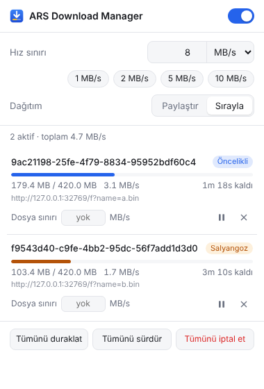

# ARS Download Manager — Kurulum Rehberi

Bu rehber **hiç bilgisayar bilgisi olmayanlar** için yazıldı. Adımları sırayla yapın, hiçbirini atlamayın.
Toplam süre: **yaklaşık 5 dakika.**

> **Bu eklenti ne işe yarar?**
> Chrome'da büyük bir dosya indirirken internetiniz kilitleniyorsa, bu eklenti indirmeyi **durdurmadan** yavaşlatır.
> Böylece indirme devam eder, siz de rahatça video izler veya gezinirsiniz.

---

## Gerekenler

- Bilgisayarınızda **Google Chrome** yüklü olmalı. Başka bir şeye gerek yok.

---

## Bölüm 1 — Kurulum

### Adım 1: Eklentiyi indirin

1. Şu sayfayı açın: **https://github.com/Arslan-TR/ARS-Download-Manager-for-chrome**
2. Sayfada **yeşil renkli `Code`** düğmesini bulun ve tıklayın.
3. Açılan küçük pencerede en alttaki **`Download ZIP`** yazısına tıklayın.

✅ **Ne olur?** Bilgisayarınıza bir dosya iner. Adı `ARS-Download-Manager-for-chrome` ile başlar ve sonu `.zip` ile biter.
Bu dosya genelde **İndirilenler** klasörüne iner.

---

### Adım 2: ZIP dosyasını açın

İnen dosya sıkıştırılmış bir paket. Önce açmamız lazım.

**Windows kullanıyorsanız:**
1. İndirilenler klasörünü açın.
2. İnen dosyaya **sağ tıklayın**.
3. **`Tümünü ayıkla...`** seçeneğine tıklayın.
4. Açılan pencerede **`Ayıkla`** düğmesine basın.

**Mac kullanıyorsanız:**
1. İnen dosyaya **çift tıklayın**. Kendiliğinden açılır.

✅ **Ne olur?** Yanında aynı isimde, **sarı bir klasör** belirir.

---

### Adım 3: Klasörü kalıcı bir yere koyun

> ⚠️ **ÇOK ÖNEMLİ:** Chrome eklentiyi her seferinde **bu klasörden** çalıştırır.
> Klasörü silerseniz veya yerini değiştirirseniz **eklenti çalışmaz.**

1. Az önce çıkan sarı klasörü **Belgeler** klasörüne taşıyın (sürükleyip bırakın).
2. İsterseniz klasörün adını kısaltın, örneğin: **`ARS Download Manager`**

🔍 **Kontrol edin:** Klasörü çift tıklayıp açın. İçinde şunları görmelisiniz:
- `manifest.json` adında bir dosya
- `icons` adında bir klasör
- `popup.html` adında bir dosya

❗ Bunları **göremiyorsanız** ve içeride aynı isimde **bir klasör daha** varsa: O iç klasör asıl klasördür. Sonraki adımlarda **iç klasörü** kullanın.

---

### Adım 4: Chrome'un eklenti sayfasını açın

1. **Chrome'u açın.**
2. En üstteki adres çubuğuna (normalde site adresi yazdığınız yere) tam olarak şunu yazın:

   ```
   chrome://extensions
   ```

3. Klavyede **Enter** tuşuna basın.

✅ **Ne olur?** "Uzantılar" yazan bir sayfa açılır.

---

### Adım 5: "Geliştirici modu"nu açın

1. Bu sayfanın **sağ üst köşesine** bakın.
2. **`Geliştirici modu`** yazısının yanındaki **anahtara** tıklayın. Mavi olmalı.
   *(Chrome'unuz İngilizceyse adı `Developer mode`.)*

> 🙂 Korkmayın, bu zararsızdır. Sadece bilgisayarınızdan eklenti yüklemenize izin verir.

✅ **Ne olur?** Sayfanın üst kısmında birkaç yeni düğme belirir.

---

### Adım 6: Eklentiyi yükleyin

1. Sol üstte beliren **`Paketlenmemiş öğe yükle`** düğmesine tıklayın.
   *(İngilizcesi: `Load unpacked`.)*
2. Bir klasör seçme penceresi açılır.
3. **Adım 3'teki klasörü** bulun (Belgeler'in içinde).
4. Klasörün **içine girmeyin**, sadece **bir kere tıklayıp seçin.**
5. **`Klasör seç`** düğmesine basın.

✅ **Ne olur?** Sayfada **mavi ikonlu "ARS Download Manager"** kartı belirir. Kurulum tamam! 🎉

❗ Kırmızı bir hata çıktıysa ve içinde **"manifest"** kelimesi geçiyorsa: yanlış klasörü seçtiniz. Adım 3'teki **🔍 Kontrol edin** kısmına geri dönün.

---

### Adım 7: İkonu araç çubuğuna sabitleyin

Eklentiyi kolay açabilmek için ikonunu görünür yapalım.

1. Chrome'un **sağ üst köşesindeki yapboz parçası (🧩)** şeklindeki düğmeye tıklayın.
2. Listede **ARS Download Manager**'ı bulun.
3. Yanındaki **raptiye (📌)** işaretine tıklayın.

✅ **Ne olur?** Sağ üstte **mavi, aşağı oklu** küçük bir ikon belirir. Artık eklentiyi buradan açacaksınız.

**Kurulum bitti!** Şimdi nasıl kullanılacağına bakalım.

---

## Bölüm 2 — Kullanım



### Hızı sınırlamak (en temel kullanım)

1. Sağ üstteki **mavi aşağı oklu ikona** tıklayın. Küçük bir pencere açılır.
2. Pencerenin **sağ üstündeki anahtarı** açın. Mavi olmalı.
3. Hazır düğmelerden birine tıklayın: **`1 MB/s`**, **`2 MB/s`**, **`5 MB/s`** veya **`10 MB/s`**.

Bu kadar! İndirmeleriniz artık seçtiğiniz hızı geçmez.
Sınırı kaldırmak için anahtarı tekrar kapatın.

> 💡 **İpucu:** Sınır açıkken eklenti ikonunun üzerinde küçük bir yazı görürsünüz. Örneğin **`2M`** = "2 MB/s sınırı açık."

---

### Hangi hızı seçmeliyim?

İnternet paketiniz genelde **Mbps** ile söylenir (örneğin "50 Mbps"). Eklentideki hazır düğmeler ise **MB/s**.

**Kolay hesap:** Mbps'i **8'e bölün**, sonra **yarısını** seçin.

| İnternet paketiniz | Bu hızda indirir | Önerilen sınır |
|---|---|---|
| 16 Mbps | ~2 MB/s | **1 MB/s** |
| 50 Mbps | ~6 MB/s | **3 MB/s** (kutuya 3 yazın) |
| 100 Mbps | ~12 MB/s | **5 MB/s** |
| 1000 Mbps (fiber) | ~120 MB/s | **10 MB/s** veya daha fazlası |

Kendi değerinizi yazmak isterseniz: **"Hız sınırı"** kutusuna sayıyı yazın ve **Enter**'a basın.
Yanındaki küçük menüden birimi de seçebilirsiniz: **KB/s**, **MB/s** veya **Mbps**.

---

### "Dağıtım" ayarı: Paylaştır mı, Sırayla mı?

Bu ayar sadece **aynı anda birden fazla dosya** indirirken önemlidir.

- **Paylaştır:** Hız bütün indirmelere **eşit** bölünür. Hepsi aynı anda ilerler.
  *Örnek: Sınır 4 MB/s, 2 indirme var → her biri ~2 MB/s.*
- **Sırayla:** **İlk başlayan** indirme hızın neredeyse tamamını alır, o bitince sıradaki başlar.
  Sıradakiler bu arada **"Salyangoz"** modunda çok yavaş ilerler. **Tamamen durmazlar**, böylece bağlantıları kopmaz.

Emin değilseniz **Paylaştır**'da bırakın.

---

### Listedeki etiketler ne anlama geliyor?

Her indirmenin yanında renkli küçük bir etiket vardır:

| Etiket | Anlamı |
|---|---|
| **Kısıtlanıyor** (mavi) | Bu indirme sınırınıza göre yavaşlatılıyor. |
| **Öncelikli** (mavi) | Sırayla modunda şu an önde olan indirme. |
| **Salyangoz** (turuncu) | Sırayla modunda sırasını bekliyor, çok yavaş ilerliyor. |
| **Sınırsız** (yeşil) | Sınır kapalı, tam hız iniyor. |
| **Duraklatıldı** (gri) | Siz duraklattınız. Eklenti buna **dokunmaz**. |

---

### Diğer düğmeler

- **⏸ / ▶** (her indirmenin yanında): O indirmeyi duraklatır veya devam ettirir.
- **✕** (her indirmenin yanında): O indirmeyi **iptal eder.**
- **Dosya sınırı** kutusu: Sadece **o dosyaya** ayrı bir hız sınırı koyar. Boş bırakırsanız ayrı sınır olmaz.
- **Tümünü duraklat / Tümünü sürdür:** Bütün indirmeleri birden durdurur veya devam ettirir.
- **Tümünü iptal et:** Bütün indirmeleri iptal eder. Yanlışlıkla basmayın diye **iki kere tıklamanız** gerekir.

---

### "Hız neden zıplıyor?" — Bu normal!

Eklenti indirmeyi çok kısa aralıklarla durdurup devam ettirerek yavaşlatır.
Bu yüzden indirme **parça parça** gelir: bazen hızlı, bazen hiç.
Penceredeki hız **son 20 saniyenin ortalamasıdır** ve doğrudur. Anlık zıplamaları dert etmeyin.

---

## Bölüm 3 — Sorun mu var?

**❓ "Manifest" kelimesi geçen kırmızı bir hata aldım.**
→ Yanlış klasörü seçtiniz. İçinde `manifest.json` dosyası olan klasörü seçmelisiniz. Bölüm 1, Adım 3'e bakın.

**❓ Chrome her açılışta "geliştirici modu uzantıları" ile ilgili bir uyarı gösteriyor.**
→ Bu normal, eklentiyi mağaza yerine bilgisayarınızdan yüklediğiniz için çıkar.
Uyarıyı **kapatın** (✕). **"Devre dışı bırak" gibi bir düğmeye basmayın**, yoksa eklenti kapanır.

**❓ Eklenti bir gün aniden kayboldu veya çalışmıyor.**
→ Büyük ihtimalle klasörü sildiniz ya da taşıdınız. Klasörü geri koyun veya Bölüm 1'i baştan yapın.

**❓ Sınırı açtım ama indirme hâlâ çok hızlı.**
→ Pencerenin sağ üstündeki anahtarın **mavi** olduğundan emin olun.
→ Hız 20 saniyelik ortalamadır, biraz bekleyin.
→ Çok hızlı bir internette çok düşük bir sınır koyduysanız (örneğin fiberde 0,5 MB/s), eklenti bağlantı kopmasın diye sınırı tam tutamayabilir. Sınırı biraz yükseltin.

**❓ Microsoft Edge, Brave veya Opera'da çalışır mı?**
→ Muhtemelen evet, adımlar aynı. Sadece Adım 4'te adres farklıdır (Edge'de `edge://extensions`). Ama bu tarayıcılarda **test edilmedi.**

---

## Bölüm 4 — Güncelleme ve kaldırma

### Yeni sürüme güncellemek

1. Bölüm 1, **Adım 1 ve 2**'yi tekrar yapın (yeni ZIP'i indirip açın).
2. Eski klasörün **içindeki her şeyi silin**, yeni klasörün içindekileri oraya kopyalayın.
3. `chrome://extensions` sayfasını açın.
4. ARS Download Manager kartındaki **yuvarlak ok (↻)** düğmesine basın.

### Eklentiyi kaldırmak

1. `chrome://extensions` sayfasını açın.
2. ARS Download Manager kartındaki **`Kaldır`** düğmesine basın.
3. İsterseniz Belgeler'deki klasörü de silebilirsiniz.

---

## Güvenli mi?

Evet.
- Eklenti **internete hiçbir veri göndermez**, hesap istemez, reklam göstermez.
- Sadece şu üç izni kullanır:
  - **İndirmeler:** İndirmelerinizi görmek ve yavaşlatmak için.
  - **Depolama:** Seçtiğiniz hız ayarını hatırlamak için.
  - **Alarmlar:** Arka planda düzenli çalışmaya devam etmek için.
- Bütün kodu bu sayfada açıkça görebilirsiniz.
